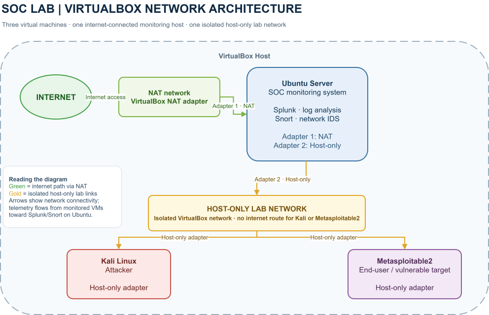

# Security Operations Center Lab
Here I deployed three virtual machines using VirtuaBox. The objective is to create an environment where I can simulate the duties of a SOC Analyst. **Goal**: to familiarize myself with Security Analyst tools, such as Snort, Splunk and Wireshark. Documented below is everything I did from setup, execution, capture, to final report; along with issues I solved along the way.

---
## Virtual Machines Used:
- Ubuntu Live Server 2024 (Blue Team Machine)
- Kali Linux (Red Team Machine)
- Metasploitable2 (End user)
---

