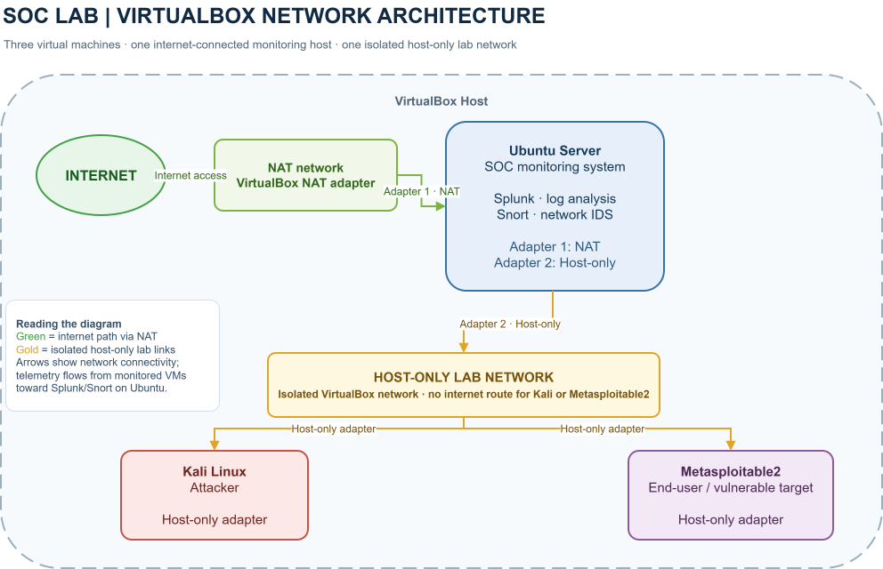

# SOC-Lab
Hey 👋! Welcome to my SOC Analyst Lab! Here I've created a simulated environment using VirtualBox, where I deployed 3 virtual machines to simulate the interaction
between an attacker, a user, and the monitoring machine.
---
## Virtual Machines Used:
- Ubuntu Live Server 2024 (Blue Team Machine)
- Kali Linux (Red Team Machine)
- Metasploitable2 (End user)
---

